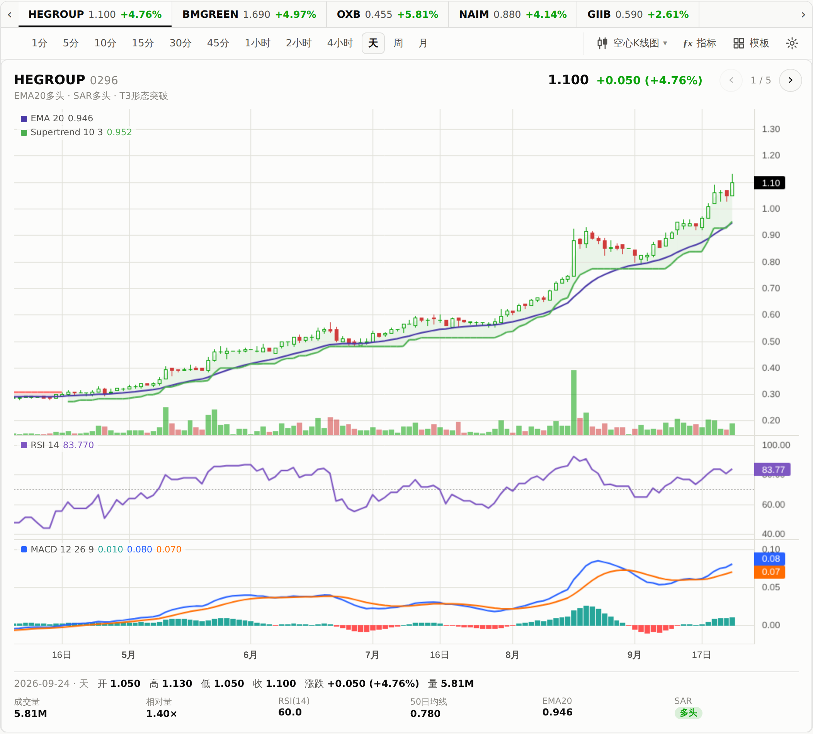
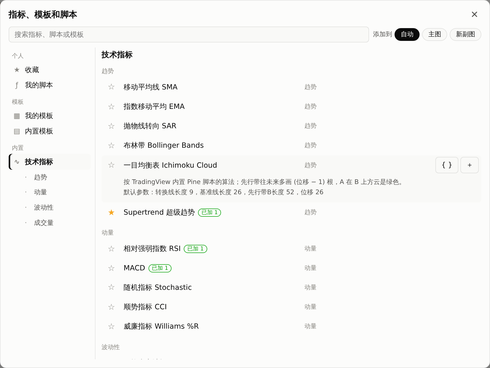
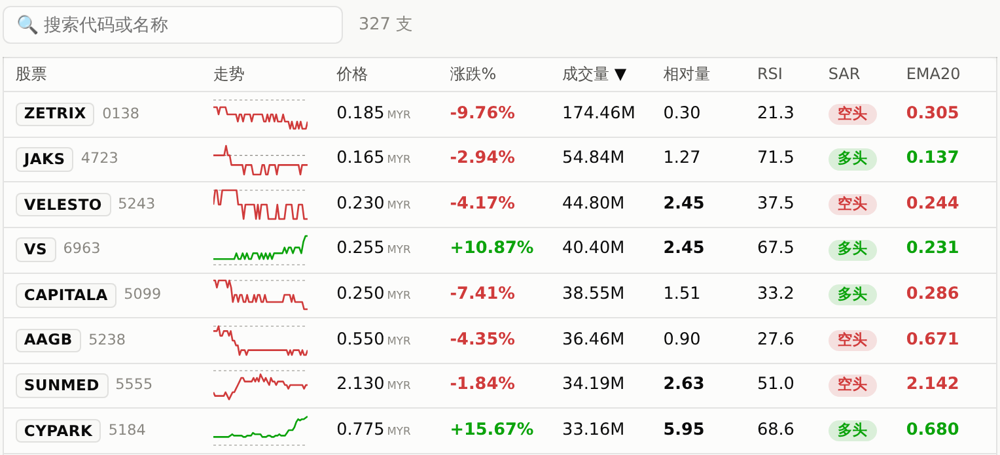

# 📢 Bursa Bot

🇲🇾 马来西亚全市场自动选股机器人 — 技术指标策略筛选 + K线图 + 回测 + 终端版 + AI 公司资讯 / 企业活动日历 + 手机推送，GitHub Actions 全自动运行，中文 / English 双语

[](./LICENSE)
[](https://www.deepseek.com/)
[](https://github.com/tradingview/lightweight-charts)

**👉 [查看今日报告](https://cja231.github.io/Bursa-bot/)** · **[终端版](https://cja231.github.io/Bursa-bot/terminal/)** · [使用条款与免责声明](https://cja231.github.io/Bursa-bot/terminal/legal.html)

---

## 这是什么

Bursa Bot 每个交易日自动扫描 **马来西亚交易所全部上市股票**（Main + ACE 板，共 1070+ 支，新上市的股票会自动加入），用一套固定的技术指标策略筛选出可能值得关注的股票，生成一份带 K 线图的网页报告，并在有信号时推送到手机。

另外有一个独立的 **美股页面**（[`/us/`](https://cja231.github.io/Bursa-bot/us/)，市值 ≥ 100 亿美元、纽交所 / 纳斯达克挂牌的股票），跟马股页面用同一套策略和网页功能，左上角 ☰ 可以互相切换。网页上还能**自己组合选股条件**、存成模板，在报告里的全部股票中筛选。

同一份数据还有一个 **终端版**（[`/terminal/`](https://cja231.github.io/Bursa-bot/terminal/)）：ASCII 终端风格、键盘操作，分成信号 / 市场 / 观察列表 / 回测 / 股票池 / 公告 / 日历 7 页，另有 DeepSeek 整理的公司资讯、企业活动日历和「✦ AI」问答，整个界面可以切换 **中文 / English**（见下方[终端版](#终端版-terminal)）。

这是一个**个人自用的技术分析工具**，不提供投资建议，也不构成任何形式的证券服务（详见下方[免责声明](#免责声明)）。

## 界面预览

**筛选器**：命中策略的股票做成卡片，**左右滑动或点上方的股票标签**切换，一次看一支，信号再多页面也不会变长。工具栏可以切换 1 分钟到月线等周期、换图表类型、加指标和套用模板。下图主图叠加了 Supertrend，下方两个副图是 RSI 和 MACD。

<picture>
  <source media="(prefers-color-scheme: dark)" srcset="assets/screenshots/signal-card-dark.png">
  
</picture>

**指标库**：照 TradingView「指标、衡量标准和策略」的方式分类，可以搜索、收藏、存自己的公式脚本，也可以套用内置模板；每个指标加到图上后都能点名称修改参数、颜色和位置。

<picture>
  <source media="(prefers-color-scheme: dark)" srcset="assets/screenshots/indicator-dialog-dark.png">
  
</picture>

**选股表格**：没有命中信号、但成交量达标的股票，每行一个当天的日内迷你走势图（虚线 = 昨收），默认按成交量排序，可搜索。

<picture>
  <source media="(prefers-color-scheme: dark)" srcset="assets/screenshots/table-dark.png">
  
</picture>

<sub>截图均取自真实运行的行情数据（筛选器为 2026-09-24 15:45 命中的 HEGROUP 0296；表格为 2026-09-23 15:46 那次运行的前 8 行），仅用于展示界面，不构成任何买卖建议。</sub>

## 报告怎么看

界面只放标题、数字和按钮，**说明都收在 ⓘ 里** (指标名称下面有虚线的也可以点)，点一下就在旁边弹出这一条的解释。

报告从上到下：标题 + 更新时间 (旁边标「盘中」「开市前」或「已收盘」) → 今日市场 → 筛选器 (选股条件、后台信号 + 策略回测) → 公司公告 → 其余股票；左上角另有 ☰ 导航，最下方固定一个搜索栏：

### ☰ 导航 (左上角)
点标题左边的 ☰ 打开侧边导航：
- **市场**：马股 / 美股两个页面互相切换
- **概览**：后台信号几支、报告里共几支、当前选股条件命中几支、更新时间，以及跳到各区块的链接
- **工具**：股票计算器、名词解释 (见下方)
- **自选**：自己加的自选股，显示现价、涨跌，点一下打开
- **筛选器种类**：我的模板 + 内置选股策略，点一下就切换过去；「新建筛选器」直接建一个空模板并打开条件编辑器，「管理模板」打开模板列表
- **下载报告**：最近 7 个交易日的 CSV / Excel / PDF (见下方)

**返回键 / 返回手势**：打开的对话框、导航会先关掉，不会直接离开页面。看某支股票时网址会变成 `…/#s=代码`，把这个链接发给别人 (或按详情里的「分享」)，打开就直接看到那支股票。可以用浏览器的「添加到主屏幕」，像 app 一样全屏打开。

### 今日市场
- **大盘指数**：马股 KLCI；美股标普 500、纳斯达克、VIX。最新点位、今天涨跌和近一个月走势
- **全市场涨跌家数**：上涨 / 平盘 / 下跌的比例条，全市场成交额，创 52 周新高 / 新低的家数 (全部上市股票，不只是进报告的)
- **涨幅榜 / 跌幅榜 / 成交额**：报告里各前 3 名 (涨跌榜只看成交额 ≥ RM100 万 / 1 亿美元的，免得被仙股跳一格占满)，点一下打开；另外写报告里的股票今天成交额是前 20 天平均的几倍

### 筛选器
标题下面那行小字是当前模板（筛选器）的名称，点一下可以改名。一个模板 = **选股条件** + 图表上的指标。

**自定义选股条件**：在「选股条件」面板点「＋ 添加条件 / ✎ 编辑条件」：
- 每条条件 = 左边 比较 右边，例如「当前价格 > EMA(20)」「RSI(14) 上穿 30」「相对量(20) ≥ 2」「T3 形态突破 成立」。选项分组列出：**价格** (当前价格、昨日收盘、今日开盘 / 最高 / 最低、前 N 日最高 / 最低)、**均线 · 趋势** (SMA、EMA、SAR、Supertrend)、**动量 · 波动** (RSI、MACD 线 / 信号线、涨跌%、ATR%)、**成交量** (成交量、成交量均线、相对量)、**形态** (T3 形态突破)；右边也可以填固定数字 (会标单位：RM / %、倍、股)；均线、RSI 这类可以改用几日计算；**SAR、Supertrend、MACD 的参数也能改** (SAR 加速因子 / 上限、Supertrend ATR 周期 / 倍数、MACD 快线 / 慢线 / 信号线)，例如 Supertrend 改成 ATR 3、倍数 1.4 → 条件写成「当前价格 > Supertrend(3,1.4)」，存进模板、回测、设为后台信号都带着这组参数
- **当前价格** = 报告更新时的最新成交价，跟表格"价格"一栏一样 (收盘后就是当天收盘价)
- 也可以直接写**公式条件**，例如 `close > ref(high,1) and volume > 2*sma(volume,20)`（支持 `> < >= <= == !=`、`and / or / not`，以及 `ref`、`crossup`、`crossdown`、`max`、`min`、`round`、`psar`、`supertrend`、`t3` 等函数）
- 「全部满足」、「至少满足 N 条」或「任一满足」；公式可以用 `within(条件, N)` = 最近 N 天内成立过 (例如 `within(crossup(close, psar()), 3)` = 3 天内 SAR 转多)；改了立刻保存，编辑器里实时显示目前命中几支。两边单位不一样（例如拿当前价格跟 RSI 比）会提醒
- 编辑器每条条件一张小卡片，下拉框、数字框统一高度、右边对齐；手机上分三行，电脑上一行排完
- 结果：用报告里**每支股票最新一根日线**判断，命中的按成交量从高到低列出来，每一行附上条件里的数值 (例如「RSI(14) 28.3」「相对量(20) 2.4」)，点一行打开完整图表 + 财报
- **回测这组条件**：打开「自定义回测」，用这组条件 + 离场规则回测近 6 个月 (见下面「策略回测」)
- **内置选股策略**：后台默认策略（= 后台信号现在用的 strategy.json，结果一致）、RSI 超卖回升、均线金叉、放量突破、MACD 金叉、Supertrend 转多
- 模板存在自己的浏览器里；「我的模板」里可以改名、**导出备份 / 导入备份**（换手机或电脑时用）

**策略回测 (Backtest)**：「后台信号」下面有一块回测，用近 6 个月日线把后台策略每一天都判断一次：信号当天收盘后，**隔天开盘价计入**；之后每天收盘检查**离场规则**，哪一个先发生就按那天收盘价结算；每笔扣来回交易成本 (马股约 0.5%，美股 0.1%)。离场规则分三组 (默认：浮动 HL + SAR 转空 + EMA5 下穿 EMA20 + 最多持有 30 天)：
  - **止损 Stop**：固定止损 %；**浮动 HL** (Trailing HL) = 收盘跌破最近一个已确认的波段低点 (左右各 N 根K线都比它高)，持有期间每出现一个更高的低点就往上移、只升不降；**回调红K** (Pullback Red Candle) = 收盘跌破信号日前 10 根里最近那根红K (收盘 < 开盘) 的最低价
  - **止盈 Target**：固定止盈 %；**历史高点** (Prior High) = 收盘涨到信号日之前的最高价 (回测数据最多约 6 个月；已经在新高上面的那一笔没有这个目标)；**近期阻力** (Resistance) = 收盘涨到信号日前约 3 个月里、在计入价上面最近的一个波段高点
  - **趋势 · 时间**：SAR 转空、EMA 死叉、最多持有几天
- **按月份统计**：上一个完整月份 (基准) / 本月至今 / 合计 三栏，例如 10/15 看 = 9/1~9/30、10/1~10/15、9/1~10/15
- 指标中英文对照：胜率 Win Rate、期望值 Expectancy、合计盈亏 Net P/L、盈亏比 Payoff Ratio、获利因子 Profit Factor、最大回撤 Max Drawdown、持有中浮动 Open P/L、系统品质 SQN、最多连亏 Max Losing Streak
- **金额换算 (每笔 RM20,000)**：期望值下面写每笔平均赚 / 亏多少 RM，合计盈亏 = 这段期间一共多少 RM；**最大回撤用 %** = 假设每个信号都买、每笔 RM20,000，本金 = 同时最多持有几笔 × RM20,000，本金加上已赚的从最高点往下掉最多的百分比 (下面小字是那一段亏掉多少 RM)。每笔金额在「自定义回测」里可以改
- 信号之后固定 5 / 10 / 20 天的涨跌，跟**同期任意一天买进** (基准 Benchmark) 比，超额 Excess
- 风险与报酬：初始风险 Initial Risk、期间最大涨幅 / 跌幅 MFE / MAE、平均 R 倍数、最好 / 最差一笔、离场原因、月度表现、收益分布，以及**最近 20 个交易日的信号现在怎样**，点一行打开那支股票
- **「自定义回测 ›」**：换进场条件 (后台信号、自己的模板、内置策略，可以改条件、换指标、改指标参数)、调离场规则和成本，在浏览器里马上重算；底部「设为后台信号 ›」左边四个分页：
  - **总览**：跟上面一样的月份统计和各项指标
  - **分类**：按离场原因 / 股票 / 持有天数 / 进场月份分组，每组几笔、胜率、期望值 (% + 每笔 RM)、合计 RM
  - **追溯**：逐笔列出每一笔 (股票、进场 / 离场日期和价格、持有天数、离场原因、收益 % 和 RM)，可以只看赚 / 亏 / 持有中；点一笔打开那支股票的日线图，图上标出进场「进」和离场「出 ±x%」并放大到那一段，还画出那一笔的**浮动 HL (阶梯线，看得到它怎么往上移)**、回调红K 低点、历史高点 / 近期阻力目标；**⤓ CSV** 下载全部交易明细 (中英文表头，多一栏盈亏 RM，Excel 直接打开)
  - **图表**：累计盈亏曲线 Equity Curve (RM，下面一格是回撤 %)、每月期望值柱状图 (每笔 RM)；**⤓ 图片** 下载曲线图 (PNG)
- 离场规则按 止损 / 止盈 / 趋势 · 时间 / 成本 · 金额 分组；「每笔金额」默认 RM20,000，可以改
- 满意了按 **「设为后台信号 ›」** (见下面)
- 最大回撤按每天的累计收益算 (同一天结算的几笔先加起来)，Python 后台和网页一样
- 只统计今天进报告的股票 (有幸存者偏差)，历史统计不代表未来；ⓘ 有完整说明

**多套后台策略**：strategy.json 的 `strategies` 可以放几套，任何一套命中就是信号；信号卡片上面有「全部 / 各策略」按钮分类，卡片上标命中的策略。内置策略里有 **SAR · EMA · Supertrend 转多** (成交量 > 1000 万、价格 0.10 ~ 5.00、3 天内 SAR 转多 + EMA5 上穿 EMA20 或 EMA10 + Supertrend(3,1.4) 转多)，可以在自定义回测里「加进后台策略」。

**账户模式回测**：每笔 RM20,000、最多同时 3 个仓位 (`slots`)；满了新信号跳过，要等止盈 / 止损空出仓位 (隔天起) 才补；同一天有几个信号只剩一两个空位时，先买相对量最高的。最大回撤按 3 × RM20,000 本金算。入场风险 = 最新价到最近一次回调低点 (HL)。

**模板管理**：改后台 / 内置策略的条件时沿用同一份模板 (不再一直生出「(副本)」)；套用内置策略也一样；☰ 里每个模板旁边有 ✎ 改名、🗑 删除，自定义回测来源旁边也有「改名」(页面里的对话框，手机上也能用)。

**后台信号自定义 (`strategy.json`)**：后台信号的条件和回测的离场规则写在仓库根目录的 [`strategy.json`](./strategy.json)，写法跟网页选股条件一样 (马股、美股共用)：
1. 网页「策略回测」→「自定义回测 ›」，调好进场条件和离场规则
2. 按「设为后台信号 ›」：内容自动复制，再按「打开 GitHub 编辑 strategy.json ›」
3. 在 GitHub 把原来的内容全部换掉、贴上，按 **Commit changes** → 下一次自动运行起，信号卡片、策略回测、推送都用新的一组
- 文件写错或删掉会自动退回默认策略 (EMA20 多头 + SAR 多头 + T3 形态突破)，不会让运行失败；运行日志第一行写着现在用的是哪一组、有没有写错
- `exit` 里的离场规则：`stop_pct` 固定止损 %、`swing_low` 浮动止损 = 收盘跌破最近回调低点 (用收盘价；0 = 不用)，`swing_mode` 怎么确认回调低点 (`rebound` = 连续收跌之后第一根收涨那天确认；`t2` = 左右各 `swing_low` 根确认)，每确认一次更高的回调低点止损就往上移，`swing_alert: true` = 只提醒不离场；`max_risk` = 进场价到最近回调低点超过这个 % 就不进场 (不是止损)、`red_candle` 回调红K、`take_pct` 固定止盈 % (`take_trail: true` = 涨到这个 % 不马上卖，开始锁利润，之后趋势健康检查坏掉任何 1 个就止盈)、`combo` 趋势健康检查 (按顺序：`st` 收盘跌破 Supertrend(`st_n`,`st_m`)、`sar` SAR 转空、`support` 跌破最新更高低点、`vol` 放量抛售 = 收跌且量 ≥ 20 天均量几倍、`emax` EMA`emax_f` < EMA`emax_s`、`ema` 收盘 < EMA；坏掉 `need` 个就离场)、`hold_st` Supertrend 还在价格下面就继续拿、`ema_break` 连续几天收盘 < EMA 全部离场、`prior_high` 历史高点、`resistance` 近期阻力、`sar` SAR 转空、`ema_cross` EMA 死叉 ([快, 慢]，null = 不用)、`max_hold` 最多持有天数 (0 = 不限)；可选 `cost_pct` 来回成本 %、`position_rm` 回测换算金额的每笔金额 (不写 = 20000)。用「设为后台信号」产生的内容会全部写好

**后台信号**：符合 strategy.json 条件 (默认 = 下面「功能特色」里的四个条件) 的股票，每支一张卡片，做成**左右翻阅的卡片轮播**：
- **上榜理由带数字**：例如「当前价格 > EMA(20) +2.8% · 当前价格 > SAR +5.2% · T3 形态突破 · 量 2.1×」(现价比 EMA20 / SAR 高多少、今天量是平时几倍)；交易时间内生成的报告标「盘中」(日线还没收完，收盘前信号可能消失)
- **切换股票**：手机上左右滑；电脑上点右上角的 ‹ ›，或点最上面一排股票标签（显示名称、现价、涨跌%）
- **工具栏**（对所有卡片生效）：
  - **周期**：「分时 ▾」(1分 / 5分 / 10分 / 15分 / 30分 / 45分 / 1小时 / 2小时 / 4小时，手机上就在按钮下面展开成 3×3 小格) + 天 / 周 / 月。分时K线的长度受 Yahoo 限制：**1 分钟约 5 个交易日；5 ~ 45 分钟约 40 个交易日 (60 天)；1 / 2 / 4 小时约 6 个月 (约 125 个交易日)**。第一次选分时才下载那支股票的分时文件 (图表上先显示「载入中…」)，平时不拖慢整页
  - **图表类型 ▾**：照 TradingView 分组——美国线、K线图、空心K线图 ｜ 线形图、带标记线、阶梯线 ｜ 面积图、HLC区域、基准线 ｜ 柱状图、高-低 ｜ 平均K线图（砖形图、卡吉图等非时间轴图表暂不支持，会显示灰色）
  - **ƒx 指标**、**模板**：打开指标库（见下方）
  - **⚙**：颜色设置
- **图表左上角**：每个指标的名称和数值（跟着十字光标变）。**点名称就能改参数**（设置窗口左下角也能删除）；旁边有 👁 隐藏、⚙ 设置、↑ ↓ 调顺序、🗑 删除（电脑上鼠标移过去出现，手机上点一下这一行出现）
- **图表下方**：十字光标所在那根 K 线的时间、开高低收、涨跌、成交量，以及成交额、相对量、RSI(14)、EMA20、50 日均线、SAR (多空 + 价位)、ATR(14) 波动、**风险 (到离场线)** = 现价跌到最近的离场线 (SAR / 浮动 HL / 回调红K / 止损) 要跌多少、**风险报酬比** = 回测里同类信号期间最大涨幅的中位数 ÷ 风险
- 标题下方的「**完整图表 · 财报 ›**」：放大看这支股票的图表，并附上近 4 季和近 2 年的财报（见下方）

### 公司公告
报告里的股票最近 14 天的公告 (马股 = Bursa Malaysia 的公司公告，经 KLSE Screener 抓取 —— Bursa 官网挡掉了 GitHub Actions 的机器；美股 = SEC EDGAR 申报文件)，每条有日期、股票、分类 (财报、派息·权益、企业活动、持股变动、回购、异常交易、人事、会议·年报) 和标题，点标题看原文、点股票名打开那支股票；上面的分类按钮可以只看某一类。每支股票的完整公告在详情里 (见下方)。

### 其余股票
没有命中信号、但成交量达标的股票，仿 TradingView 选股器的紧凑表格：

| 列 | 含义 |
|---|---|
| # | 序号，排序或筛选后自动重新从 1 编号 |
| 股票 | 马股 = 简称 + 股票代码；美股 = 代码 + 公司名 (全名太长，代码放前面)；新股标「上市 N 天」(天数不够算的指标显示「—」)；马股低价股标「跳一格 N%」(0.035 的股票跳一格就是 14%) |
| 走势 | 当天的日内迷你走势图，虚线是昨收；拿不到日内数据时显示近 30 日走势 |
| 价格 / 涨跌% | 最新价，以及相对昨收的涨跌 |
| 成交量 / 相对量 | 今天成交量，以及它是过去 20 天平均的几倍（≥ 2 倍加粗；平时几乎没成交、超过 20 倍的显示「20+」） |
| RSI | 14 日 RSI |
| SAR | 抛物线指标当前是多头还是空头 |
| EMA20 | 20 日均线，绿色 = 价格在均线上方，红色 = 下方 |

默认**按成交量**从高到低排，点表头 (手机上用排序下拉框) 可以换排序；成交额在点开的详情顶部。上方的**快速筛选**可以叠加：★ 自选、SAR 多头、放量 ≥ 2×、RSI < 30、RSI > 70、排除 RM0.10 以下 (美股 $5 以下)。电脑上表格撑满整个页面宽度；手机上每支股票排成两行刚好塞进屏幕（第一行：名称、走势、价格；第二行：成交量、相对量、RSI、SAR、EMA20、涨跌%），数字用短格式 (81.1M) 不会挤在一起，排序改用下拉框。

**点任何一行**（键盘选中后按 Enter）打开这支股票的完整图表和财报：

### 完整图表 + 财报 + 公告 + 新闻
- **最上面**：☆ 加自选、计算器、分享 (手机上用系统分享，电脑上复制链接)，右边 ‹ › 按打开时那个列表的顺序 (表格现在的排序和筛选、命中列表、榜单…) 换上一支 / 下一支
- **关键数字**：今日成交额 (是 20 日平均的几倍)、市值、市盈率、股息率、52 周区间 (小条上的点 = 现价位置)、下次财报日期 (两周内会标出来)、20 日平均成交额、ATR 波动、一手 (100 股) 多少钱
- **K 线图**：跟筛选器卡片同一套图表——5 分钟到月线的周期、图表类型、ƒx 指标和模板都能用，图例点名称改参数。日线最长 2 年、月线最长 10 年；信号股的分时跟卡片同一份 (1 小时线约 6 个月)；表格股票的日内周期是当天的 5 分钟线合成的（没有 1 分钟线，这个按钮显示灰色）
- **财务报表**：「近 4 季」和「近 2 年 (年报)」两个分页。营业收入、净利润、净利率、经营现金流各一张小柱状图（最新一期标数值，旁边写**环比 (较上季) 和同比 (较去年同季)** / 较上年的变化，季节性行业看同比才准；由盈转亏会直接写「转亏」），下面是完整数字表格：营收、毛利、营业利润、净利润、净利率、EPS、总资产、总负债、股东权益、现金、总债务、经营现金流、自由现金流
- 数据来自 Yahoo Finance，金额单位按公司报告的货币标示（马股一般是令吉 RM）；Yahoo 没有财报的小公司会注明。完整的年报 PDF 在 Bursa 官网的公司公告里，底下有链接
- **公司公告**：这支股票最近半年的公告 (马股经 KLSE Screener、美股 SEC EDGAR)，日期、分类、标题，点标题看原文；还没抓到时给官方公告页的链接
- **最近新闻**：按公司全名搜 Google News (拿不到时用 Yahoo Finance)，列出最近 90 天的 8 条标题、来源和时间，点标题看原文；标题里带别的交易所代码的 (同名的外国公司) 会过滤掉；每支股票半天更新一次
- **版面**：电脑上左边是正方形 K 线图、右边是财报，公告、新闻在下面；手机上从上到下排
- 这些数据平时不跟着网页一起下载，打开哪一支才下载哪一支，整页不会因此变慢

**底部搜索栏**：页面最下方固定一个搜索框，滑到哪里都能直接打股票名称或代码（电脑上按 `/` 就能开始打），列出今天报告里符合的股票和现价、涨跌，点一下或按 Enter 直接打开完整图表 + 财报 + 新闻。

**手机上滑动**：图表上下滑 = 滑动页面（左右拖才是移动图表），右边的价格轴不能拖；图表和表格右边都留了一条带细线的空白，给拇指滑页面用。页面惯性滑动时点一下是停下来，不会误开股票。

### 股票计算器 (☰ → 工具，或详情里的「计算器」)
- **交易成本 · 保本价**：填买入价、卖出价、数量 (马股可以按手或股)，算出买卖两边的佣金、结算费、印花税，买入总成本、卖出实收、净赚 / 净亏，以及**保本卖价** (扣完买卖费用刚好打平，按最小跳动往上取)
- **按风险算股数**：填本金、这一笔最多愿意亏多少、进场价、风险价 (例如 SAR)、预期卖价 → 可以买几股 (按一手取整，连买卖费用一起算也不超过愿意亏的金额)、需要多少资金、跌到风险价亏多少、风险报酬比
- 马股默认收费：佣金 0.1% 最低 RM8、结算费 0.03% 最多 RM1,000、印花税每 RM1,000 (不足也算) RM1 最多 RM1,000，买卖各收一次；普通股佣金不收 SST (ETF / REIT / 权证要)。**每家券商不一样，在「收费标准」里改，会记住**
- 美股：按美元算，另外按汇率 (每次运行抓最新的美元兑令吉) 和换汇差价换成令吉

### 名词解释 (页面上的 ⓘ 点一下弹出那一条；☰ → 工具 看全部)
当前价格、盘中 / 已收盘、成交额 / 成交量、相对量、RSI、EMA20、SAR、T3 形态、ATR、风险报酬比、回测的胜率 / 期望值 / 盈亏比 / 获利因子 / 最大回撤 / SQN / R 倍数 / 离场规则 (中英文)、财报单位、计算器收费标准、跳一格、52 周区间、市盈率 / 股息率等 44 条白话说明。

### 下载报告
☰ 导航最下面「下载报告」展开后，有一条**最近 7 个交易日**的日期选择条（手机上可以左右滑），点哪一天就下载哪一天：
- **每天一份**：选好日期后可以看到那天的更新时间、信号股和股票数量，再点 CSV / Excel / PDF 下载（同一天运行多次的话，保留的是当天最后一次的结果）
- **近 7 天合并**：一个 Excel（每天一个工作表）和一个 CSV（多一列日期）

Excel 里涨跌% 按涨跌上色、表头可以筛选；CSV 带 BOM，用 Excel 直接打开中文不会乱码；PDF 为横向 A4，适合打印或存档。超过 7 天的旧文件会自动删除。

### ƒx 指标库和模板
点工具栏的「ƒx 指标」或「模板」打开，分类方式照 TradingView：
- **个人**：收藏（在指标前点 ☆）、我的脚本（自己写公式，例如 `sma(close,10)`、`ema(close,12)-ema(close,26)`，存起来以后一点就能加）
- **模板**：我的模板（切换、另存、改名、删除、导出 / 导入备份）、内置模板（分两组：6 个带条件的选股策略；5 个指标组合——趋势跟随、一目均衡表、动量组合、波动率、量价。套用后会复制成自己的模板）
- **内置技术指标**：趋势 / 动量 / 波动性 / 成交量，共 16 个，参数都能改——SMA、EMA、SAR、布林带、一目均衡表、Supertrend、RSI、MACD（线 + 信号线 + 柱）、Stochastic、CCI、Williams %R、ATR、布林带带宽、成交量均线、OBV、滚动 VWAP
- **添加到**：自动 / 主图 / 新副图。自动 = 均线类叠在主图，RSI、MACD 这类震荡指标在下方另开副图
- 加进来的指标会**实时保存**到当前模板

所有设置只保存在你自己的浏览器里，不影响其他人，报告每次自动更新后也会保留。

## 终端版 (/terminal/)

[`/terminal/`](https://cja231.github.io/Bursa-bot/terminal/) 用同一次运行的数据，做成 ASCII 终端风格的界面 (深灰底 + Nord 色系，[t] 切换浅色主题)。由 `terminal_site.py` 从 `terminal_assets/` 生成到 `docs/terminal/`，每次跑报告时一起更新。标准报告和终端版可以互相切换 (页脚「⚙ 标准风格」)。

- **顶部跑马灯**：KLCI、涨 / 平 / 跌家数、USD/MYR、更新时间，接着是成交额前 10 和成交量前 10 (价格 < RM0.10 的仙股不算)，卡其色高亮
- **7 个页面** (键盘 `1`–`7` 切页、`/` 搜索、`k` 空心 / 实心K线、`q` 返回)：
  1. **信号**：命中后台策略的股票 + 最近信号的追踪 (信号之后走了多少)
  2. **市场**：大盘、涨跌家数、涨跌榜，以及 **ASCII 热力图** (可以选 24 / 50 / 80 / 全部，按成交额排；点下方的涨跌图例只看那一档，旁边写着每档几支)
  3. **观察列表**：自己建文件夹分类、加股票、搬到别的文件夹；可以导出 / 导入备份 (换手机时用)；全部存在自己的浏览器
  4. **回测**：后台账本，或者**自定义回测** —— 自己选进场条件、选一支或几支股票合在一起算、自定回测期间
  5. **股票池**：成交量 ≥ 1M 的全部股票，名称前有股票代码，各栏可以正 / 反方向排序
  6. **公告**：最近的公司公告，一排可以左右滑的分类按钮筛选；AI 标出值得注意的公告 (📌 重要事件 / ⚠ 留意事项，**只表示「值得注意」，不代表利好或利空**)
  7. **日历**：最上面是 **IPO 新股** (招股中 / 待上市的认购、抽签、上市日期和招股价；近 12 个月已上市的超额认购倍数、首日开盘 / 收盘、上市至今的涨跌和汇总统计)，下面是企业活动日历 (会议、派息、财报、企业活动、新上市，IPO 的日期也画在月历上)，月历格子 + 列表，可以按类别筛选 (见下方)
- **字符 K 线**：默认是**空心K线** (跟 TradingView 一样：收盘 > 开盘画空心框、收盘 < 开盘实心，颜色看收盘比前一天涨还是跌)，图表右下角的按钮或 `k` 切换成全部实心；设置存在自己的浏览器
- **个股页**：K 线图、关键数字、财报图表 (营收 / 净利润 / 净利率 / 现金流的阶梯图和柱状图 + 完整表格)、**公司简介** (官网链接、背景、业务线)、**AI 公司资讯** (近况、重要事件、留意事项、财报一两句)、公告和新闻
- **✦ AI 问答**：每一页右下角的 ✦ 按钮，把当前页面的资料附上去问 DeepSeek (见下方[设置](#-ai-问答设置))
- **中文 / English**：页脚的 EN 按钮切换整个界面，包括数据里的中文 (分类、理由、日历事件、AI 资讯都有英文版)；语言跟标准报告共用同一个设置
- **离线也能看 (PWA)**：在 iPhone Safari 按「分享 → 添加到主屏幕」，像 app 一样打开。有网时永远先拿最新的；没网 (或 8 秒连不上) 时显示最后一次的页面、日线和新股资料，顶部标「离线 · 显示的是 xx 的数据」。只缓存终端版自己的文件 (约 1MB)，个股财报 / 公告 / 新闻和 AI 问答还是要上网
- **字体自托管**：JetBrains Mono 完整版 (含 K 线用的方块和框线字符) 放在网站里，不连 Google Fonts，手机上 K 线粗细一致
- **使用条款**：页脚链接到 [`legal.html`](https://cja231.github.io/Bursa-bot/terminal/legal.html) (中英双语：不构成投资建议、风险、资料来源、AI 内容、责任限制、知识产权、隐私)

## 公司资讯与企业活动日历 (DeepSeek)

`scripts/company_intel.py` 用 DeepSeek 把每家马股公司「最近发生什么事」整理成中英文，跟每日报告分开跑 (`.github/workflows/company_intel.yml`)：
- **新公告模式**：每次报告跑完自动接着跑 (`workflow_run`)，读全市场最新公告，只重新整理有新的非例行公告的公司 (持股变动、股份回购不算)，每次最多 20 家 —— 公告出来后大约 30 分钟内反映到 AI 资讯和日历；收盘后大部分公告在 5pm 以后发布，所以 cron-job.org 晚上也排了几次报告
- **完整轮换**：马来西亚时间平日晚上 7:17，补还没有资讯、或超过 7 天没更新的公司 (最多 120 家)；也可以手动跑，参数 `new_only` / `limit` / `codes` / `force`

每家公司的处理：

- **收集**：KLSE Screener 的公告 (标题 + 公告内文)、Google News / Yahoo 新闻、`docs/stock/` 里的季报 (同比 / 环比由程序算好，DeepSeek 只负责描述)、公司简介
- **输出** (`docs/intel/<代码>.json`)：近况 2~3 句、重要事件、留意事项、财报一两句，每条公告一个标签 (重要 / 留意 / 例行)；全部只陈述事实，提示词要求 + 程序再过滤一次，不出现「利好 / 利空 / 买入 / 卖出」这类字眼
- **企业活动日历** (`docs/intel/calendar.json`)：从公告里抽出股东大会、特别大会、除权日、权益登记日、派发日、上市日 (权证、红股、附加股) 等日期；另外按季度结束 + 2 个月推算「财报截止日」
- 输入没变就不再问 DeepSeek，超过 7 天才重新整理；`docs/intel/index.json` 给终端版公告页和日历用

## 在网页上编辑内容 (owner)

网站管理员可以在终端版直接修改 **AI 公司资讯、公司中文简介、企业活动日历、IPO 超额认购 / 上市日**：
- ✦ AI → ⚙ 设置里填「编辑通行码」后，各模块旁边出现 ✎；一般访客看不到，Worker 也会检查通行码
- 编辑框里可以直接改，也可以写指令叫 AI 改写 (例如「把近况缩短成两句」「加上 11/10 公告的合约金额」)，可以贴公告原文当参考资料；AI 改过的栏位会标出来，可以撤销
- 按「保存并发布」：Worker 把你的版本提交到 `docs/terminal/overrides.json`，约 1–2 分钟后所有人看到的就是更正后的资料 (你这台设备马上显示)；页面上不另外标示
- **自动更新时核对合并**：`company_intel.py` 优先重新整理你编辑过的公司，AI 新版本和你的版本对照公告、新闻、财报核实后合并：你的写法有根据就保留，AI 找到的新事件补进去，跟资料矛盾的按资料改、找不到根据的保留，两种都列在只有你看得到的方框里；IPO 你填的倍数 / 日期跟自动抓到的不一样也会提示
- 「恢复成自动版本」删掉你的编辑；设置步骤见 [`worker/README.md`](./worker/README.md)

## 新股 IPO 资料 (`ipo_calendar.py`)

马股报告每次运行时顺便更新 (每 6 小时最多抓一次 IPO 页)，状态存在 `data/ipos.json`，终端版读 `docs/terminal/ipo.json`：
- **KLSE Screener IPO 页** (`/v2/ipos`)：代码、简称、招股价、开始 / 截止认购、抽签、分配、上市日期、发行规模、市值、板块 (Main / ACE / LEAP)、行业 (不登入看得到最近约两年)
- **超额认购倍数**：同一网站个股页新闻栏的标题 (例如「… IPO oversubscribed 36.46 times」)，标题里要有公司名称才算；找不到就留空，不猜
- **首日开盘 / 收盘、上市至今**：Yahoo Finance 不复权日线，跟招股价比；首日那根定了就不再改
- 只记录事实，不评论好坏，也不构成认购建议；手动测试：Debug Stock workflow 的 symbol 填 `IPO`

## ✦ AI 问答设置

网页是公开的静态网站，API 密钥不能放在网页里。两种连法，在 ✦ →「⚙ 设置」里选，设置只存在这台设备的浏览器：
- **Worker (推荐)**：部署 [`worker/ai-proxy.js`](./worker/ai-proxy.js) 到免费的 Cloudflare Workers，密钥放在 Cloudflare 的 Secret，网页只填 Worker 网址和自己定的通行码。步骤见 [`worker/README.md`](./worker/README.md)
- **自己的 DeepSeek 密钥**：浏览器直接连 DeepSeek，不用 Cloudflare，但密钥存在手机上

## 功能特色

- 🔍 **全市场扫描**：覆盖 Bursa Malaysia 全部上市股票，不只是自选股清单
- 🇺🇸 **美股页面**：另一个独立页面扫描市值 ≥ 100 亿美元的美股（纽交所 / 纳斯达克，日成交额 ≥ 2000 万美元），一样的策略、图表、财报和新闻，时间按美东时间（夏令时自动处理）
- 🧩 **自定义选股条件**：网页上自己组合条件（下拉选择或写公式，全部满足 / 任一满足），存成模板，在报告里的全部股票中实时筛选；另有 6 个内置选股策略，其中「后台默认策略」跟后台信号结果一致
- 🎯 **量化策略 (可以自定义)**：条件写在 `strategy.json`，可以在网页上回测好再换成自己的条件。现在的一组：SAR 当天转多、价格 > EMA20、EMA5 > EMA20、成交量 ≥ 1M 股、Supertrend(3,1.4) 在价格下面、价格 > EMA50 或 EMA5 > EMA50，另外市值 ≤ RM3B、价格 ≥ RM0.10、最近 40 天不是窄幅横盘 (完整说明在 `strategy.json` 的「说明」)。后台信号和回测另有按价格分级的成交量门槛，越便宜的股票要求越高 (「其余股票」/ 股票池则放进成交量 ≥ 1M 的全部股票)：

  | 价格 (RM) | 最低日成交量 |
  |---|---|
  | 0.10 以下 | 500 万 |
  | 0.10 – 0.20 | 300 万 |
  | 0.20 – 0.50 | 100 万 |
  | 0.50 以上 | 50 万 |
- 🧪 **策略回测 + 风险报酬**：用近 6 个月日线逐日回测后台策略，离场规则可以调 (止损：固定 %、浮动 HL、回调红K；止盈：固定 %、历史高点、近期阻力；SAR 转空、EMA 死叉、最多持有天数)；按月统计 (上个月当基准 + 本月至今)，胜率 Win Rate、期望值 Expectancy (每笔 RM20,000 赚多少)、合计盈亏、获利因子 Profit Factor、最大回撤 Max Drawdown (%) 等中英文对照，跟同期任意一天买进比；自定义回测里按离场原因 / 股票 / 持有天数 / 月份分类、逐笔追溯到 K 线图，交易明细下载 CSV、累计收益曲线下载图片；每张信号卡片标出到离场线的风险和风险报酬比
- 🌏 **今日市场**：大盘指数、全市场涨跌家数、52 周新高 / 新低、涨跌榜和成交额榜
- 📢 **公司公告**：马股 Bursa 公告 (经 KLSE Screener)、美股 SEC EDGAR 申报，公告栏按分类筛选，每支股票的详情里也有
- 🖥 **终端版**：ASCII 终端风格、键盘操作的第二套界面，跑马灯、热力图、观察列表文件夹、自定义回测、股票池、财报图表、公司简介 (见上方)
- 🗓 **AI 公司资讯 + 企业活动日历**：DeepSeek 整理每家公司的近况、重要事件和留意事项，从公告里抽出股东大会、除权、派息、上市等日期做成日历；只陈述事实、不判断好坏
- ✦ **AI 问答**：终端版任何一页都能把当前资料附上去问 DeepSeek (经自己的 Cloudflare Worker 或自己的密钥)
- 🌐 **中文 / English**：标准报告和终端版都能切换英文，版面按英文重新对齐
- 🧮 **股票计算器**：马股佣金、结算费、印花税、保本卖价，按风险算股数；美股按汇率换成令吉
- ⭐ **自选股 + 分享链接**：自选股存在自己的浏览器里；每支股票都有自己的网址，可以分享；返回手势先关对话框
- 📈 **多周期 K 线图**：卡片轮播一次看一支，1 分钟到月线 12 种周期 (1 / 2 / 4 小时线约 6 个月)、11 种图表类型一键切换，指标可放主图或副图，悬停看开高低收
- ⚙️ **网页端自定义**：16 个可调参数的指标（SAR、布林带、一目均衡表、Supertrend、RSI、MACD、KD、CCI、ATR、OBV、VWAP 等），点图例就能改参数；也能自己写公式；指标组合存成模板，另有 5 个内置模板
- 📊 **选股器式表格**：每支股票都有日内迷你走势图、成交量、相对成交量、多空标签，默认按成交量排，快速筛选可以叠加；点任何一行看完整 K 线图
- 🧾 **财报可视化**：每支股票近 4 季、近 2 年的营收、净利润、净利率、现金流柱状图和完整数字表格，季报同时看环比和同比；顶部一排市值、市盈率、股息率、52 周区间、下次财报日期
- 🤖 **AI 辅助点评**：命中信号的股票由 DeepSeek 给出简短的技术面可靠性评价（写在下载的 Excel / PDF 里，网页图表下方只放数据）
- 📱 **手机推送**：通过 [ntfy.sh](https://ntfy.sh) 在发现信号时推送通知
- ⏰ **全自动运行**：每个交易日盘中按马来西亚时间自动更新，美股每天收盘后更新一次（详见 [`bursa-bot.md`](./bursa-bot.md) 了解排程设计）
- 📥 **报告下载**：最近 7 个交易日的报告可以下载成 CSV / Excel / PDF，也有 7 天合并版
- 🌐 **静态网页发布**：报告通过 GitHub Pages 发布，随时用手机浏览器打开查看

## 怎么运作的

```
外部定时器 (cron-job.org, 马来西亚时间；美股另一个任务按纽约时间) → 调用 GitHub Actions (market = MY / US)
        │
        ▼
yfinance 并发抓取全市场行情 (~1070 支, 16 线程并发)
        │
        ▼
pandas-ta 计算指标 (RSI / SMA50 / EMA20 / PSAR)
        │
        ▼
strategy.json 的条件筛选 (engine.py，跟网页同一套公式) + 成交量门槛 → 命中的股票交给 DeepSeek 做简短点评
        │
        ▼
生成 docs/index.html (K线图 + 选股表格 + 日内走势；美股是 docs/us/ 下面同一套)
+ docs/charts/table.json (表格股票的 6 个月日线 + 当天 5 分钟线，点开表格或用选股条件时才下载)
+ docs/charts/card/<代码>.json (信号股的分时K线：1 分钟 5 天、5 / 15 分钟 60 天、1 小时 6 个月，选分时周期时才下载)
+ docs/stock/<代码>.json (财报 + 2 年日线 + 10 年月线，每支一周更新一次，每次运行补 30 支)
+ docs/terminal/ (终端版：terminal_site.py 把 data.json / bars.json 和 terminal_assets/ 的页面一起写进去)
        │
        ▼
提交到仓库 → GitHub Pages 自动发布 → (有信号时) 推送到手机

另一个独立流程 (company_intel.yml，平日晚上一次)：
KLSE Screener 公告 + 新闻 + 季报 → DeepSeek 整理 → docs/intel/ (公司资讯 + 企业活动日历) → 提交 → 终端版读取
```

### 自动化流程 (`.github/workflows/`)

| 文件 | 做什么 | 怎么触发 |
|---|---|---|
| `daily.yml` | 跑报告 (马股 / 美股)、生成终端版、提交、推送通知 | cron-job.org 按当地时间调用 (workflow_dispatch，参数 `market`) |
| `company_intel.yml` | DeepSeek 公司资讯 + 企业活动日历 | 每次报告跑完 (新公告模式，最多 20 家)；平日 19:17 完整轮换；或手动 |
| `update-watchlist.yml` | 更新全市场股票清单 | 手动 (平时 daily.yml 每天第一次运行会自动更新) |
| `debug_stock.yml` | 调试某支股票过去几天的条件；另有 `IPO` (更新并印出新股资料)、`LATENCY` (记录各公告来源的延迟)、`PROBE*` (测试资料来源) | 手动 |

两个会 `git push` 的流程 (`daily.yml`、`company_intel.yml`) 在同一个 concurrency 组，排队跑，不会撞在一起。Actions 用 `actions/checkout@v7`、`actions/setup-python@v7`、`actions/cache@v6` (Node.js 24)。

## 技术栈

| 用途 | 技术 |
|---|---|
| 行情数据 | [yfinance](https://github.com/ranaroussi/yfinance) |
| 技术指标 | [pandas-ta](https://github.com/twopirllc/pandas-ta) |
| AI 点评 / 公司资讯 / 日历 / 问答 | [DeepSeek](https://www.deepseek.com/) API |
| 公告 / 新股 IPO | KLSE Screener (马股)、SEC EDGAR (美股) |
| AI 问答中转 (可选) | Cloudflare Workers |
| K 线图 | [TradingView Lightweight Charts](https://github.com/tradingview/lightweight-charts) v5（Apache 2.0，已自托管在 `docs/vendor/`） |
| 手机推送 | [ntfy.sh](https://ntfy.sh) |
| 自动化 | GitHub Actions + 外部定时器 |
| 发布 | GitHub Pages |

## 项目结构

```
Bursa-bot/
├── main.py                      # 主程序：抓数据 → 算指标 → 筛选 → 生成报告 → 推送
├── exports.py                   # 导出 CSV / Excel / PDF 下载文件
├── engine.py                    # 选股条件的公式引擎 (网页 report.js 同一套的 Python 版)
├── strategy.json                # 后台信号的条件 + 回测离场规则 (可以自己改)
├── terminal_site.py             # 生成终端版 docs/terminal/ (data.json、bars.json + 页面)
├── ipo_calendar.py              # 新股 IPO 日历 + 上市表现 (KLSE Screener + Yahoo)，状态在 data/ipos.json
├── public_site.py               # 生成精简版公开展示站 public_site/ (见最下方)
├── terminal_assets/             # 终端版页面原稿：index.html、terminal.js、terminal.css、terminal_en.js (英文)、legal.html (使用条款)、sw.js + manifest.webmanifest (离线 PWA)、fonts/ (JetBrains Mono + OFL 授权)
├── worker/                      # Cloudflare Worker：✦ AI 问答中转 + owner 编辑 (AI 改写、提交到 GitHub)
├── data/watchlist.json          # 全市场股票清单 (1070+ 支)
├── docs/index.html              # 生成的报告，GitHub Pages 从这里发布
├── docs/report.js               # 报告页的图表、指标、模板和表格脚本
├── docs/i18n.js                 # 标准报告的英文切换
├── docs/terminal/               # 生成的终端版 (每次运行更新)；overrides.json = 管理员在网页上的编辑 (Worker 提交)
├── docs/intel/                  # AI 公司资讯 <代码>.json、index.json、企业活动日历 calendar.json (company_intel.yml 生成)
├── docs/downloads/              # 最近 7 个交易日的下载文件 (自动生成，自动清理)
├── docs/charts/table.json       # "其余股票"点开看完整图表 / 网页选股条件用的 K 线 (每次运行更新)
├── docs/charts/card/            # 信号股的分时 K 线 (选分时周期时才下载，每次运行更新，没有信号了自动删除)
├── docs/stock/                  # 每支股票的财报 + 长期 K 线 (一周更新一次，30 天没用到自动删除)
├── docs/news/                   # 每支股票最近的新闻标题 + 链接 (半天更新一次)
├── docs/ann/                    # 每支股票的公司公告 (马股经 KLSE Screener / 美股 SEC EDGAR，半天更新一次)
├── docs/icons/                  # "添加到主屏幕"用的图标 (manifest.webmanifest 每次运行生成)
├── docs/us/                     # 美股页面：index.html + 同样的 downloads / charts / stock / news / ann (MARKET=US 时生成)
├── assets/screenshots/          # README 用的界面截图
├── scripts/
│   ├── fetch_watchlist.py       # 更新全市场股票清单
│   ├── debug_stock.py           # 调试工具：查看某支股票过去几天是否符合条件
│   ├── company_intel.py         # DeepSeek 公司资讯 + 企业活动日历 (company_intel.yml 跑)
│   ├── ann_latency.py           # 记录 KLSE Screener / i3investor 等公告来源比官方晚多久
│   └── probe_sources.py         # 测试各资料来源在 Actions 上拿不拿得到
├── .github/workflows/           # 自动化流程 (见上方表格)
├── LICENSE                      # 授权 (All Rights Reserved)
└── NOTICE.md                    # 第三方组件、字体和资料来源的授权 / 使用条款
```

更完整的设计笔记（策略细节、历史踩坑、排程调试过程）见 [`bursa-bot.md`](./bursa-bot.md)。

## 免责声明

本项目及其生成的报告：

- **不构成任何投资建议**，仅供个人技术分析学习与参考
- 所有信号均由固定的技术指标公式自动计算，**不涉及人工投资判断，也不保证准确性或盈利**
- AI 点评、公司资讯、企业活动日历和 ✦ AI 问答都是模型生成，可能存在错误或遗漏，不应作为买卖依据；📌 / ⚠ 只表示「值得注意」，不代表利好或利空
- 作者不是马来西亚证券监督委员会 (Securities Commission Malaysia) 持牌的投资顾问
- 使用本项目产生的任何投资决策及后果，由使用者自行承担

完整的使用条款、免责声明与隐私说明 (中英双语)：[terminal/legal.html](https://cja231.github.io/Bursa-bot/terminal/legal.html) (原稿在 [`terminal_assets/legal.html`](./terminal_assets/legal.html))。

## License

本仓库为 **All Rights Reserved**，详见 [`LICENSE`](./LICENSE)。仓库保持公开是为了使用免费版 GitHub Pages，并不代表开放授权使用。第三方组件 (TradingView Lightweight Charts 的 Apache 2.0、JetBrains Mono 字体的 OFL 等) 保留各自的授权；资料来源 (Yahoo Finance、KLSE Screener、Bursa Malaysia、FTSE Russell、Google News、DeepSeek) 各有自己的使用条款，详见 [`NOTICE.md`](./NOTICE.md)。

**回测账本 (Backtest ledger)**：后台回测的交易记录固定存在 `docs/backtest_ledger.json` (美股 `docs/us/`)，不会因为每天进报告的股票不同而重算。第一次 (或进场 / 离场规则、成本、仓位数改了) 用手上的日线建账本；之后只加账本建好以后新出现的信号、并让持有中的交易继续走到结算，已结算的交易不再改动。想手动重建，删掉这个文件即可。

## 公开展示站 (精简版，给更多人看)

完整报告 (`docs/`) 里有指标、进场 / 离场规则、回测，只给自己看。要给别人看，用 `public_site.py` 另外生成一份精简版 `public_site/`：
只有今日市场综述、强势股、今日机会 (价格 / 风险 / 报酬风险比)、其余股票、纯K线 + 成交量；数据文件里也只有价格、成交量、成交额，没有任何指标值或策略。

要真的保密，策略和代码必须放在**私有仓库**，精简版发布到**另一个公开仓库**：
1. 本仓库改成私有 (Settings → General → Danger Zone → Change visibility)。
2. 新建一个公开仓库 (例如 `Bursa-bot-public`)，Settings → Pages → Deploy from a branch → `main` / `(root)`。
3. 新建 fine-grained token：只选那个公开仓库，Contents = Read and write。
4. 本仓库 Settings → Secrets and variables → Actions：Secret `PUBLIC_REPO_TOKEN` = 上面的 token；Variable `PUBLIC_REPO` = `你的用户名/Bursa-bot-public`。
5. 之后 `daily.yml` 每次运行完会自动把 `public_site/` 推过去 (没设置就跳过)。

注意：私有仓库的 GitHub Pages 要付费版，而且发布出来的网址仍然是公开的 —— 所以完整版不要再用 Pages 发布，自己看的话用 Actions 跑完后拉取 `docs/` 在本机打开。
